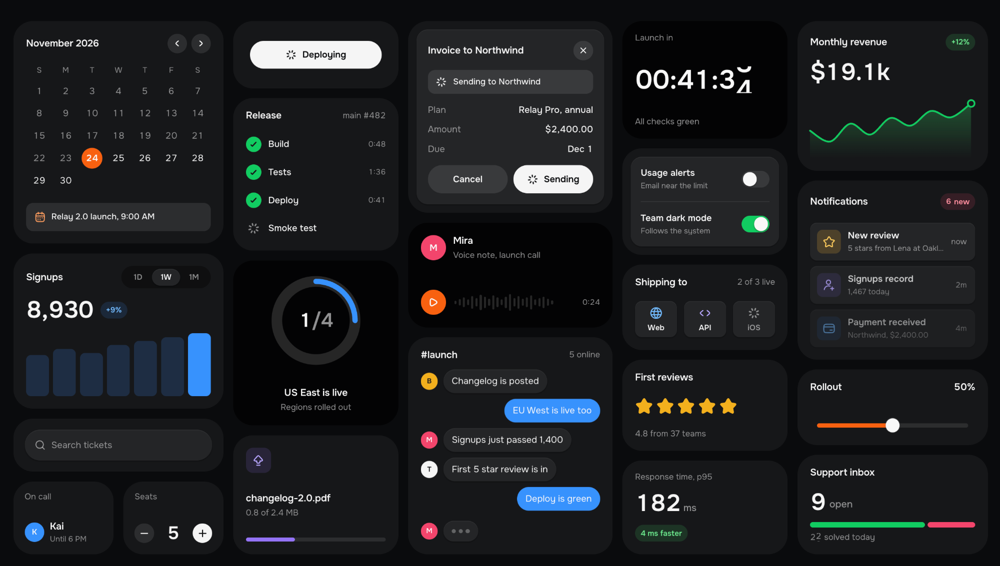

# earned-ui-skills


<sub>Liquid glass built with the <code>liquid-glass-web</code> skill: real WebGL2 refraction, tuned live in a lab.</sub>



<sub>The launch day wall built with the <code>widget-bento-web</code> skill: 21 tiles, one story, every widget stepping through its states.</sub>

UI skills for coding agents, earned the hard way. Each one folds a real
build into a workflow an agent can follow: the order to work in, the rules,
a small reference implementation to adapt, and the mistakes worth not
repeating.

A library gives you a fixed set of components. A skill gives your agent the
workflow to build its own.

## Skills

| Skill | What it builds | Status |
| --- | --- | --- |
| [`liquid-glass-web`](skills/liquid-glass-web/SKILL.md) | Apple style Liquid Glass on the web with real refraction (WebGL2), not a backdrop blur | Ready |
| [`widget-bento-web`](skills/widget-bento-web/SKILL.md) | A bento of live widgets where every tile proves something the page says, composed on every screen | Ready |

## Install

With [skills](https://github.com/vercel-labs/skills), for Claude Code, Codex,
Cursor and the other agents it supports:

```bash
npx skills add sougata-github/earned-ui-skills
```

Just one skill:

```bash
npx skills add sougata-github/earned-ui-skills --skill liquid-glass-web
npx skills add sougata-github/earned-ui-skills --skill widget-bento-web
```

Or copy a folder from `skills/` into your agent's skills directory.

## liquid-glass-web

Ask your agent for glass ("a liquid glass player widget over this image")
and the skill takes it through:

1. What sits behind the glass, and two references to judge against
2. The architecture (WebGL over owned media by default)
3. A tuning lab: your real background and a live control for every
   property of the glass
4. Each component shown in the lab first. You tweak and paste the values
   back as JSON, or keep the current ones. This is what gets you to the look
   you want, not better guesses in code
5. The tuned preset carried to every next component, still lab first
6. A verification checklist

Inside: a dependency free WebGL2 renderer (squircle edge profile, Snell's
law per colour channel, frost, Fresnel rim, fixed light, contact shadow,
shapes that melt together), a React tuning lab, Apple's rules distilled,
and the lessons from shipping it.

## widget-bento-web

Ask your agent for a bento ("a features section with live widgets for this
product") and the skill takes it through:

1. The page's claims, one story and one cast, so every tile belongs
2. The frame: rounded tiles on a canvas, or cells ruled by hairlines
3. A lab with the empty bento first. You approve which tiles and how big
   before any content exists
4. One widget at a time, each built at its real size and shown in the lab
   in both themes. You click through its states, then tweak and paste the
   values back as JSON, or keep the current ones
5. Alive by state: each widget steps through a few states, and one
   conductor wakes two tiles a beat in a fixed order
6. An arrangement per screen shape. Tiles are rearranged, never squeezed,
   and every column ends level
7. A verification checklist

Inside: a small React wall engine (plans, the fit to any window, the
conductor, an opening where the tiles land like a home screen on unlock), a
number that rolls and text that swaps, a lab, the forms a tile can take with
when to use each, and the lessons from building it.

The wall in `site/` is the skill's own lab: 21 tiles telling one launch day.

```bash
cd site && pnpm install && pnpm dev   # localhost:3200, add ?lab for the lab
```

## Credits

- Apple: [Liquid Glass](https://developer.apple.com/documentation/technologyoverviews/liquid-glass),
  [HIG Materials](https://developer.apple.com/design/human-interface-guidelines/materials),
  [WWDC25 Meet Liquid Glass](https://developer.apple.com/videos/play/wwdc2025/219)
- [Emil Kowalski's skills](https://github.com/emilkowalski/skills), the
  `apple-design` skill composes with this one for motion
- [kube.io](https://kube.io/blog/liquid-glass-css-svg/) on the physics, and
  [Liquid Glass Studio](https://github.com/iyinchao/liquid-glass-studio)

## License

The code and the skills are MIT licensed.

The images in `demo-assets/` are not. They show artwork that belongs to its
owner, all rights reserved: do not copy, reuse or redistribute them.
